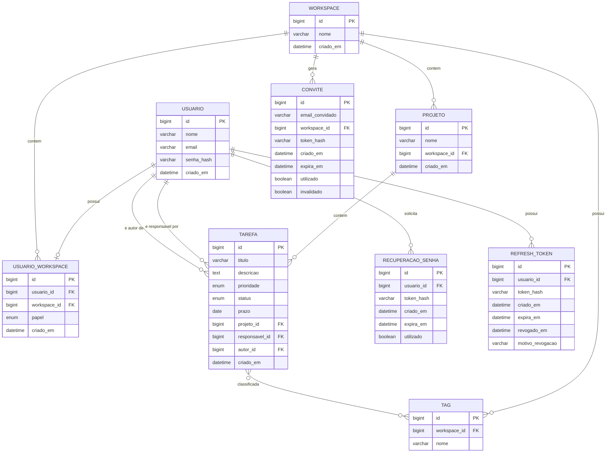

# Modelo de Dados / ER — TaskFlow (V1)

**Versão:** V1
**Revisão:** 17/10/2026
**Escopo:** Modo Equipe
**Referências:** Domínio do Sistema V1, Especificação V1, Requisitos Funcionais e Não Funcionais V1

---

## 1. Introdução

Este documento define o Modelo de Dados da V1 do TaskFlow, cobrindo exclusivamente o Modo Equipe. As entidades, atributos e relacionamentos aqui descritos foram derivados do documento de Domínio (`TaskFlow_V1_Dominio.md`), da Especificação V1 e dos Requisitos Funcionais, com decisões de modelagem validadas junto à desenvolvedora.

O banco de dados alvo é **MySQL**.

## 2. Entidades e Atributos

### 2.1 `usuario`

Representa a conta de um usuário do sistema.

| Atributo | Tipo | Observação |
|---|---|---|
| id | BIGINT AUTO_INCREMENT | Chave primária |
| nome | VARCHAR(100) | Obrigatório. Limite de 100 caracteres (RT-04) |
| email | VARCHAR(150) | Obrigatório, único. Não editável após o cadastro (RF-26) |
| senha_hash | VARCHAR(255) | Obrigatório (armazenar hash com algoritmo adaptativo, nunca a senha em texto puro) |
| criado_em | DATETIME | Obrigatório (UTC — ver seção 7) |

### 2.2 `workspace`

Ambiente colaborativo que agrupa membros e projetos.

| Atributo | Tipo | Observação |
|---|---|---|
| id | BIGINT AUTO_INCREMENT | Chave primária |
| nome | VARCHAR(150) | Obrigatório. Gerado automaticamente no cadastro sem convite, no formato `Workspace de {nome do usuário}` (RF-02). Edição fica para a V2 |
| criado_em | DATETIME | Obrigatório (UTC) |

### 2.3 `usuario_workspace`

Tabela associativa entre `usuario` e `workspace`, com o papel do usuário naquele workspace.

| Atributo | Tipo | Observação |
|---|---|---|
| id | BIGINT AUTO_INCREMENT | Chave primária |
| usuario_id | BIGINT | FK → `usuario.id`, **único** (V1: cada usuário pertence a **no máximo 1** workspace) |
| workspace_id | BIGINT | FK → `workspace.id` |
| papel | ENUM('PROPRIETARIO', 'MEMBRO') | Obrigatório |
| criado_em | DATETIME | Obrigatório (UTC) |

Observações:

- Um `usuario` pode existir **sem** registro em `usuario_workspace` (ex.: membro removido do workspace — RF-10, RF-39).
- No cadastro sem convite, `usuario`, `workspace` e o registro de `usuario_workspace` (papel `PROPRIETARIO`) são gravados em **uma única transação** (RF-01 a RF-03): ou os três são criados, ou nenhum.
- Cada `workspace` possui **exatamente 1** registro com `papel = 'PROPRIETARIO'`. A regra é garantida pela camada de aplicação (o MySQL não oferece índice único parcial). O Proprietário não pode ser removido do workspace na V1.

### 2.4 `convite`

Convite enviado por um Proprietário para ingresso de um novo membro no workspace.

| Atributo | Tipo | Observação |
|---|---|---|
| id | BIGINT AUTO_INCREMENT | Chave primária |
| email_convidado | VARCHAR(150) | Obrigatório |
| workspace_id | BIGINT | FK → `workspace.id` |
| token_hash | VARCHAR(64) | Obrigatório, único. Hash SHA-256 (hexadecimal) do token enviado no link; o token em texto puro nunca é persistido |
| criado_em | DATETIME | Obrigatório (UTC) |
| expira_em | DATETIME | Obrigatório — calculado como `criado_em` + 2 dias |
| utilizado | BOOLEAN | Padrão `FALSE`. Passa a `TRUE` quando o convite é aceito |
| invalidado | BOOLEAN | Padrão `FALSE`. Passa a `TRUE` quando um novo convite para o mesmo `email_convidado` e `workspace_id` é gerado (RF-29) |

Regras:

- Um convite é **válido** somente se `utilizado = FALSE`, `invalidado = FALSE` e a data/hora atual for anterior a `expira_em`.
- Ao gerar um novo convite para o mesmo `email_convidado` e `workspace_id`, os convites anteriores ainda pendentes são marcados como `invalidado = TRUE`.
- Não é gerado convite para e-mail de usuário que já pertença a um workspace (RF-06).
- Índice recomendado: (`email_convidado`, `workspace_id`).
- Na V1, todo convite vincula o usuário como `MEMBRO`; por isso a tabela não tem coluna de papel. Na V2, com cargos customizados, o convite passará a registrar o papel (nova coluna, por migração).

### 2.5 `projeto`

Contêiner de tarefas dentro de um workspace.

| Atributo | Tipo | Observação |
|---|---|---|
| id | BIGINT AUTO_INCREMENT | Chave primária |
| nome | VARCHAR(150) | Obrigatório. Limite de 150 caracteres (RT-04) |
| workspace_id | BIGINT | FK → `workspace.id` |
| criado_em | DATETIME | Obrigatório (UTC) |

### 2.6 `tarefa`

Unidade de trabalho do tipo Simples (único tipo existente na V1).

| Atributo | Tipo | Observação |
|---|---|---|
| id | BIGINT AUTO_INCREMENT | Chave primária |
| titulo | VARCHAR(200) | Obrigatório. Limite de 200 caracteres (RT-04) |
| descricao | TEXT | Opcional. Limite de 5.000 caracteres, validado pela aplicação (RT-04) |
| prioridade | ENUM('BAIXA', 'MEDIA', 'ALTA') | Obrigatório, padrão `MEDIA` (assumida quando a prioridade não é informada na criação — RF-16) |
| status | ENUM('PENDENTE_A_INICIAR', 'EM_DESENVOLVIMENTO', 'EM_TESTES', 'FINALIZADO') | Obrigatório, padrão `PENDENTE_A_INICIAR` |
| prazo | DATE | Opcional (não há regra na documentação exigindo obrigatoriedade). Data de calendário, sem conversão de fuso |
| projeto_id | BIGINT | FK → `projeto.id`, obrigatório |
| responsavel_id | BIGINT | FK → `usuario.id`, **obrigatório**. Na criação por Membro, é o próprio autor (RF-16); a atribuição e a alteração posterior cabem ao Proprietário (RF-20) |
| autor_id | BIGINT | FK → `usuario.id`, **obrigatório** — usuário que criou a tarefa; usado para definir "tarefa própria" nas regras de permissão (RF-18) |
| criado_em | DATETIME | Obrigatório (UTC) |

### 2.7 `tag`

Etiqueta reutilizável para categorização de tarefas, **pertencente a um workspace**.

| Atributo | Tipo | Observação |
|---|---|---|
| id | BIGINT AUTO_INCREMENT | Chave primária |
| workspace_id | BIGINT | FK → `workspace.id`, obrigatório |
| nome | VARCHAR(50) COLLATE utf8mb4_0900_ai_ci | Obrigatório. Limite de 50 caracteres (RT-04). Normalizado antes de gravar: sem espaços nas pontas e em minúsculas. A collation `utf8mb4_0900_ai_ci` ignora acentos e maiúsculas: `ação` e `acao` são a mesma tag |

Regras:

- Unicidade composta: (`workspace_id`, `nome`), segundo a collation da coluna (sem distinção de acentos e de maiúsculas). Ao digitar uma variante de tag já existente (ex.: `acao` quando `ação` existe), a tag existente é reutilizada.
- A tag é criada automaticamente quando o nome informado na tarefa ainda não existe no workspace (RF-16). Não há CRUD de tags na V1.
- Tags de workspaces diferentes são independentes (isolamento entre workspaces — RNF-01).

### 2.8 `tarefa_tag`

Tabela associativa N:N entre `tarefa` e `tag`.

| Atributo | Tipo | Observação |
|---|---|---|
| tarefa_id | BIGINT | FK → `tarefa.id` |
| tag_id | BIGINT | FK → `tag.id` |

Chave primária composta: (`tarefa_id`, `tag_id`).

Regras de aplicação: a tarefa e a tag associadas devem pertencer ao mesmo workspace, e uma tarefa tem no máximo 10 tags (RT-04).

### 2.9 `recuperacao_senha`

Token de recuperação de senha (RF-30 a RF-37).

| Atributo | Tipo | Observação |
|---|---|---|
| id | BIGINT AUTO_INCREMENT | Chave primária |
| usuario_id | BIGINT | FK → `usuario.id`, obrigatório |
| token_hash | VARCHAR(64) | Obrigatório, único. Hash SHA-256 (hexadecimal) do token enviado no link; o token em texto puro nunca é persistido |
| criado_em | DATETIME | Obrigatório (UTC) |
| expira_em | DATETIME | Obrigatório — calculado como `criado_em` + 30 minutos |
| utilizado | BOOLEAN | Padrão `FALSE`. Passa a `TRUE` após a redefinição de senha (RF-35) |

Regras:

- Um token é **válido** somente se `utilizado = FALSE` e a data/hora atual for anterior a `expira_em`.
- Ao gerar um novo token para um usuário, os tokens anteriores ainda não utilizados desse usuário são invalidados (marcados como `utilizado = TRUE`).
- Solicitações para e-mail não cadastrado não geram registro, e a resposta ao solicitante é a mesma (RF-37).
- Índice por `usuario_id`, usado para invalidar os tokens anteriores do usuário. Tokens expirados não são removidos automaticamente na V1 (risco aceito — Decisões Técnicas, seção 5).

### 2.10 `refresh_token`

Token de renovação de sessão, revogável (RF-05, RF-38).

| Atributo | Tipo | Observação |
|---|---|---|
| id | BIGINT AUTO_INCREMENT | Chave primária |
| usuario_id | BIGINT | FK → `usuario.id`, obrigatório |
| token_hash | VARCHAR(64) | Obrigatório, único. Hash SHA-256 (hexadecimal); o token em texto puro nunca é persistido |
| criado_em | DATETIME | Obrigatório (UTC) |
| expira_em | DATETIME | Obrigatório. Prazo de validade definido em `docs/arquitetura/TaskFlow_V1_Decisoes_Tecnicas.md` |
| revogado_em | DATETIME | Nulo enquanto o token não foi revogado. Preenchido (UTC) no logout (RF-38), na rotação ou na detecção de reuso |
| motivo_revogacao | VARCHAR(20) | Nulo enquanto o token não foi revogado. Valores: `ROTACAO`, `LOGOUT`, `REUSO_DETECTADO` |

Regras:

- Um refresh token é **válido** somente se `revogado_em` é nulo e a data/hora atual é anterior a `expira_em`.
- A rotação preenche `revogado_em` e `motivo_revogacao = 'ROTACAO'`. O uso de um token revogado por rotação até 10 segundos depois de `revogado_em` (janela de tolerância, Decisões Técnicas DT-05) é rejeitado sem afetar os demais tokens do usuário. Fora da janela, os demais tokens do usuário são revogados com `motivo_revogacao = 'REUSO_DETECTADO'`. O uso de token revogado por `LOGOUT` é apenas rejeitado.
- Índice por `usuario_id`, usado para revogar todos os tokens do usuário. Tokens expirados não são removidos automaticamente na V1 (risco aceito — Decisões Técnicas, seção 5).

## 3. Relacionamentos

| Relação | Cardinalidade | Regra de negócio associada |
|---|---|---|
| `workspace` — `usuario_workspace` | 1 —— N | Um workspace tem 1 Proprietário e 0+ Membros |
| `usuario` — `usuario_workspace` | 1 —— 0..1 | Um usuário pertence a **no máximo 1** workspace na V1 (unicidade de `usuario_id`); pode ficar sem vínculo após ser removido |
| `workspace` — `projeto` | 1 —— N | Um workspace tem 0 ou mais projetos |
| `workspace` — `convite` | 1 —— N | Um workspace pode ter vários convites pendentes/expirados |
| `workspace` — `tag` | 1 —— N | Cada tag pertence a um único workspace |
| `projeto` — `tarefa` | 1 —— N | Um projeto tem 0 ou mais tarefas |
| `usuario` — `tarefa` (responsável) | 1 —— N | Um usuário pode ser responsável por várias tarefas; toda tarefa tem exatamente 1 responsável |
| `usuario` — `tarefa` (autor) | 1 —— N | Um usuário pode ser autor de várias tarefas; toda tarefa tem exatamente 1 autor |
| `tarefa` — `tag` | N —— N | Via `tarefa_tag` |
| `usuario` — `recuperacao_senha` | 1 —— N | Um usuário pode ter vários tokens de recuperação ao longo do tempo; apenas o mais recente não utilizado permanece válido |
| `usuario` — `refresh_token` | 1 —— N | Um usuário pode ter vários refresh tokens ativos (um por sessão/dispositivo) |

## 4. Diagrama ER

## 5. Regras de Integridade Consolidadas

- `usuario.email` — único.
- `usuario_workspace.usuario_id` — único (garante no máximo 1 workspace por usuário na V1).
- Exatamente 1 `PROPRIETARIO` por workspace — garantido pela camada de aplicação.
- `convite.token_hash` — único.
- `convite.expira_em` — calculado como `criado_em + 2 dias` na criação do registro.
- `convite` válido — `utilizado = FALSE`, `invalidado = FALSE` e `expira_em` no futuro.
- `recuperacao_senha.token_hash` — único.
- `recuperacao_senha.expira_em` — calculado como `criado_em + 30 minutos` na criação do registro.
- `refresh_token.token_hash` — único.
- `refresh_token` válido — `revogado_em` nulo e `expira_em` no futuro; `motivo_revogacao` em (`ROTACAO`, `LOGOUT`, `REUSO_DETECTADO`).
- Índices por `usuario_id` em `recuperacao_senha` e em `refresh_token`; `convite` é indexado por (`email_convidado`, `workspace_id`).
- `tarefa.prioridade` — padrão `MEDIA`. Limites de tamanho dos campos conforme RT-04.
- `tarefa.responsavel_id` — obrigatório (não permite tarefa sem responsável).
- `tarefa.autor_id` — obrigatório (não permite tarefa sem autor registrado).
- `tag` — único por (`workspace_id`, `nome`), com `nome` normalizado (sem espaços nas pontas, em minúsculas) e comparado sem distinção de acentos e de maiúsculas (`utf8mb4_0900_ai_ci`).
- `tarefa_tag` — chave primária composta (`tarefa_id`, `tag_id`), evitando associação duplicada da mesma tag à mesma tarefa; tarefa e tag do mesmo workspace (aplicação).
- Tokens (convite, recuperação de senha e refresh) são armazenados somente como hash (RNF-13).

## 6. Exclusão de Registros (V1)

A V1 implementa **exclusão física** (`DELETE`), sem soft delete. Não há campos de status de exclusão (ex: `ativo`, `removido_em`) neste modelo. Não há exclusão de conta de usuário nem de workspace na V1.

| Ação | Comportamento de exclusão (FK) |
|---|---|
| Excluir projeto (RF-15) | `projeto` → `tarefa`: **`ON DELETE CASCADE`** — todas as tarefas do projeto são excluídas junto |
| Excluir tarefa (RF-19) | `tarefa` → `tarefa_tag`: **`ON DELETE CASCADE`** — os vínculos de tag da tarefa são removidos; a `tag` em si permanece (pode ser usada por outras tarefas do mesmo workspace) |
| Remover membro do workspace (RF-10) | Exclui apenas o vínculo em `usuario_workspace`; o registro em `usuario` **não é excluído** — a conta permanece existindo, sem vínculo com workspace (RF-39). A operação é **atômica** (uma única transação): (1) o Proprietário escolhe o novo responsável; (2) todas as tarefas sob responsabilidade do membro (`tarefa.responsavel_id`) são reatribuídas a ele — qualquer outro membro do workspace ou o próprio Proprietário; (3) o vínculo é removido. Se qualquer etapa falhar, nenhuma alteração é persistida. Regra de negócio tratada na camada de aplicação, não como constraint de banco. O Proprietário não pode ser removido. As tarefas criadas pelo membro (`autor_id`) permanecem com seu autor original |

## 7. Fuso Horário

Todos os campos `datetime` (`criado_em`, `expira_em`) são armazenados em **UTC**. A conversão para **America/Sao_Paulo (UTC−03:00)** ocorre apenas na apresentação (cliente web). A API trafega datas e horas em ISO-8601 com indicação de UTC.

- O MySQL `DATETIME` não armazena informação de fuso — cabe ao backend Spring Boot gravar e interpretar os valores sempre em UTC (fuso padrão da JVM e da conexão JDBC configurados em UTC), de forma consistente em toda a base.
- Os cálculos de expiração (`expira_em` de convites, tokens de recuperação e refresh tokens) são feitos e comparados em UTC.
- `tarefa.prazo` (`DATE`) é data de calendário, sem horário, e não sofre conversão de fuso.

## 8. Observações e Pontos em Aberto

- Este modelo cobre exclusivamente a V1. Evoluções futuras (múltiplos workspaces por usuário, vínculo seletivo membro-projeto, subtarefas, comentários e anexos) exigirão extensão deste modelo, não contemplada neste documento.
- `tarefa.prazo` permanece opcional, por não haver requisito que o torne obrigatório na criação.
- `tarefa.autor_id` foi incluído para suportar a regra de RF-18, que distingue "tarefa própria" (criada pelo usuário) de "tarefa sob responsabilidade" (`responsavel_id`). Autor e responsável podem ser a mesma pessoa ou pessoas diferentes.
- Decisões registradas na revisão de 15/10/2026:
  - Nova entidade `recuperacao_senha` (RF-31, RF-35) e nova entidade `refresh_token` (RF-05, RF-38).
  - `convite.token` substituído por `token_hash`; incluído `convite.invalidado` (RF-06, RF-29).
  - `tag` passa a pertencer a um workspace, com unicidade composta (isolamento entre workspaces).
  - Usuário pode existir sem workspace (membro removido); regra "no máximo 1 workspace por usuário".
  - Remoção de membro com reatribuição obrigatória das tarefas, em transação única.
  - Fuso horário: armazenamento em UTC, com conversão na apresentação (substitui a decisão anterior de gravar em America/Sao_Paulo).
- Decisões registradas na revisão de 17/10/2026:
  - `usuario.nome` limitado a 100 caracteres; demais limites de campos em RT-04 (Requisitos).
  - Criação atômica de `usuario`, `workspace` e `usuario_workspace` no cadastro sem convite.
  - `tarefa.prioridade` com padrão `MEDIA`; descrição limitada a 5.000 caracteres; no máximo 10 tags por tarefa.
  - `tag.nome` com collation `utf8mb4_0900_ai_ci` (sem distinção de acentos); o e-mail do usuário mantém a collation padrão do banco.
  - `refresh_token`: `revogado` substituído por `revogado_em` e `motivo_revogacao`, para a janela de tolerância de reuso.
  - Índices por `usuario_id` em `recuperacao_senha` e `refresh_token`. Tokens expirados sem limpeza automática (risco aceito).
  - O convite não tem papel na V1 (sempre `MEMBRO`); o papel entra na V2.
- Pendências de modelagem: nenhuma conhecida na data desta revisão. Novas pendências devem ser registradas nesta seção.
